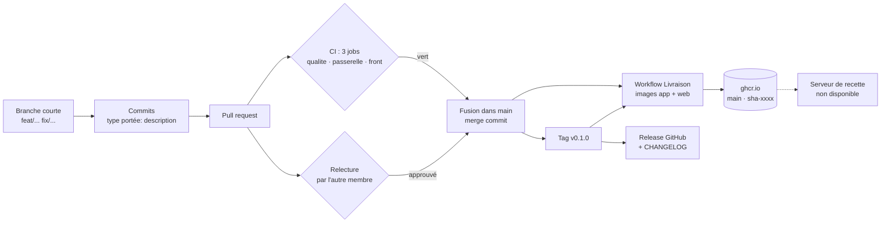

# SAÉ 5 · Rendu 7 · Environnement de développement

**Projet** : logiciel de gestion des Jardins de Cocagne (Laravel 13, PHP 8.3, PostgreSQL 16, Docker)
**Binôme** : Damien RINALDIS · Ethan STASSE
**Année universitaire** : 2026-2027
**Dépôt** : https://github.com/EthanStasse/SAE_5_RINALDIS_STASSE · **Version** : v0.1.0 (25/11/2026)

Ce document décrit l'environnement de développement du projet : le dépôt collaboratif, la chaîne de production (intégration continue), le paquetage Docker et la livraison continue. Il explique nos choix, les alternatives écartées, ce que nous avons appris et les limites.

---

## 1. Vue d'ensemble : le chemin d'une modification



| Étape | Outil | Ce qui est garanti |
| --- | --- | --- |
| Travail | branche courte | `main` n'est jamais modifiée directement |
| Vérification | GitHub Actions (CI) | style, analyse statique, tests PHP et Python, compilation du front, failles connues |
| Revue | pull request | une approbation de l'autre membre est obligatoire |
| Fusion | branche `main` protégée | impossible sans CI au vert et sans approbation, même pour un administrateur |
| Livraison | workflow Livraison | chaque fusion et chaque version produit des images Docker prêtes à déployer |
| Version | tag SemVer + release | on peut retrouver et redéployer exactement une version |

---

## 2. Dépôt collaboratif

### 2.1 Organisation du dépôt

| Élément | Rôle |
| --- | --- |
| `README.md` | présentation, structure, démarrage rapide, badge CI |
| `CONTRIBUTING.md` | règles de travail : branches, commits, pull requests, relecture, fusion |
| `CHANGELOG.md` | journal des versions, écrit pour des humains |
| `Code/` | application Laravel |
| `materiel/` | Arduino, ESP32, passerelle Raspberry Pi |
| `.github/workflows/` | `ci.yml` (vérifier) et `livraison.yml` (produire) |

### 2.2 Protection de `main`

Réglée dans GitHub (Settings → Branches) :

- pull request obligatoire, avec **1 approbation** (l'auteur ne peut pas approuver sa propre PR) ;
- approbation annulée si de nouveaux commits arrivent après ;
- vérifications de la CI obligatoires et branche à jour avec `main` ;
- **aucun contournement**, même pour le propriétaire du dépôt ; pas de force push, pas de suppression.

Test réalisé : un `git push origin main` direct est refusé (`GH006: Protected branch update failed … Changes must be made through a pull request`).

### 2.3 Convention de commits

Format `type(portée): description (exigence)`, par exemple :
`feat(auth): blocage du compte 15 minutes après 5 échecs, sans révéler les comptes (EF-D-06, EF-D-07)`.

Les types (`feat`, `fix`, `test`, `docs`, `ci`, `build`…) disent la nature du changement, la portée (`auth`, `serre`, `paniers`, `docker`…) dit le module. L'historique devient lisible et le CHANGELOG se rédige à partir de lui. Les premiers commits du projet (« fix », « Add files via upload ») ne suivaient pas cette convention : elle s'applique depuis le 17/11, et nous n'avons pas réécrit l'historique (cela aurait demandé un force push sur `main`).

---

## 3. Réflexion : branches, fusion, contributions

### 3.1 Stratégie de branches : GitHub Flow

| | Git Flow | **GitHub Flow (choisi)** | Trunk-based |
| --- | --- | --- | --- |
| Branches permanentes | `main` + `develop` | `main` | `main` |
| Branches temporaires | feature, release, hotfix | une par tâche | aucune ou de quelques heures |
| Adapté à | logiciels à versions maintenues en parallèle | applications web livrées en continu | grandes équipes avec feature flags |
| Pour nous | trop lourd sur 3 semaines | simple, relecture à chaque PR | pas de relecture avant intégration |

GitHub Flow tient en une règle : *`main` est toujours stable et déployable*. Il s'accorde avec la livraison continue (chaque fusion produit une image) et permet quand même des versions, par des tags sur `main`, sans branche `release`.

Nommage : `type/portee-description` (`feat/auth-2fa-admin`, `build/docker-prod`, `ci/livraison-images`). Une branche = une tâche, supprimée automatiquement après fusion.

### 3.2 Mode de fusion : merge commit

| Mode | Effet sur `main` | Décision |
| --- | --- | --- |
| **Merge commit** | tous les commits conservés + un commit « Merge pull request #n » | **choisi** : chaque commit garde son auteur et sa date, la progression reste visible, chaque fusion renvoie à sa PR |
| Squash and merge | un seul commit par PR | historique propre mais progression effacée |
| Rebase and merge | commits recopiés, historique linéaire | commits réécrits, lien avec la PR moins visible |

Contrepartie assumée : chaque commit doit être propre, d'où la convention de messages.

### 3.3 Contributions et relecture

Règle : relecture croisée. Ethan relit les PR de Damien (cybersécurité, serre, CI, Docker, livraison) et Damien relit celles d'Ethan (paniers, modèles de PR et d'issues). Le relecteur vérifie l'exigence, les tests, l'isolation entre Jardins, l'absence de secrets.

Bilan au 25/11 : 24 pull requests ouvertes ; depuis la protection de `main` (17/11), aucune modification n'y est arrivée sans pull request, CI au vert et approbation.

**Point faible reconnu** : la répartition des commits est déséquilibrée (environ 89 pour Damien, 3 pour Ethan hors fusions). Ethan a contribué surtout par la relecture, les fusions et la correction de l'installation sous Windows ; le module paniers (A) qui lui revient n'est pas encore commencé. Nous le corrigeons dans la suite du projet.

### 3.4 Ce que nous avons appris (incidents réels)

| Incident | Cause | Ce qui l'a révélé | Leçon |
| --- | --- | --- | --- |
| PR #2 « tests de la passerelle » fusionnée vide | mauvais fichier copié | `git diff --stat` affichait 2 lignes au lieu de 36 | vérifier le diff avant chaque commit ; le relecteur doit lire « Files changed » |
| Branches poussées vides (`Total 0`) | commande lancée depuis `Code/` au lieu de la racine, ou sur `main` | absence de PR proposée par GitHub | vérifier `git branch` et `1 file changed` avant de pousser |
| CI rouge sans changement de code (25/11) | faille publiée le 17/11 dans `web-auth/webauthn-lib` (passkeys) | `composer audit` dans la CI | la CI protège aussi contre les failles découvertes après coup ; correction 5.3.12 → 5.3.17 dans une PR dédiée |
| Erreur 502 après recréation du conteneur `app` | nginx gardait l'ancienne adresse IP de PHP-FPM | test local du compose de production | `resolver` Docker dans nginx ; tester un « faux déploiement » avant la recette |
| Version de PHP visible (`X-Powered-By`) | réglage par défaut de PHP | test des en-têtes avec `curl` | `expose_php = Off` |

---

## 4. Chaîne de production (intégration continue)

Fichier `.github/workflows/ci.yml`, déclenché sur chaque pull request et sur chaque fusion dans `main`.

| Job | Contenu | Pourquoi |
| --- | --- | --- |
| `qualite` | PHP 8.3 · Pint (style) · Larastan (analyse statique) · tests Pest sur PostgreSQL 16 · `composer audit` | tester sur la même base de données qu'en production ; bloquer les dépendances vulnérables |
| `passerelle` | Python 3.11 · pytest (16 tests) | même version que Raspberry Pi OS, qui exécute la passerelle |
| `front` | Node 22 · `npm ci` · `vite build` · présence de `manifest.json` | une erreur CSS/JS ou une dépendance npm cassée se voit avant la fusion |

Choix :

- **jobs séparés** : ils tournent en parallèle et un échec désigne tout de suite la partie en cause ;
- **déclencheurs** : `pull_request` + `push` sur `main` uniquement, pour ne pas lancer deux fois la CI sur le même code ; `concurrency` annule une exécution devenue inutile ;
- **`npm ci`** plutôt que `npm install` : installation exacte et reproductible du `package-lock.json`.

**Cache composer et npm**, mesuré sur deux exécutions du même commit :

| Job | Sans cache | Avec cache |
| --- | --- | --- |
| `qualite` | 1 min 22 s | 1 min 08 s (−17 %) |
| `front` | 10 s | 10 s |

On met en cache les téléchargements, pas `vendor/` ni `node_modules/` : l'installation est toujours vérifiée. Le gain est modeste aujourd'hui car la plus grande partie du temps vient de PostgreSQL, Larastan et des tests.

---

## 5. Paquetage Docker

### 5.1 Développement et production : deux usages différents

| | Développement (`docker-compose.yml`) | Production (`docker-compose.prod.yml`) |
| --- | --- | --- |
| Code | monté depuis le poste | **dans l'image** |
| Outils | Mailpit, Node | aucun outil de développement |
| Base de données | port 5433 exposé | **aucun port exposé** |
| HTTPS | non | Caddy |
| Secrets | `.env` local | `.env.production`, jamais versionné |

### 5.2 Image de production multi-stage (`Code/Dockerfile`)

```
base (PHP 8.3-FPM + extensions)
 ├─► vendor   composer install --no-dev, autoloader optimisé
 │     └──► front (Node 22) : npm ci + vite build
 ├─► web      nginx + public/ + front compilé
 └─► production : code + vendor + front, utilisateur www-data
```

| Choix | Justification |
| --- | --- |
| multi-stage | composer, Node et npm servent à construire mais ne sont pas livrés : image plus petite, surface d'attaque réduite |
| même base qu'en développement (`php:8.3-fpm`) | pas d'écart entre le poste et le serveur |
| `composer.json`/`.lock` copiés avant le code | la couche des dépendances est réutilisée tant qu'elles ne changent pas |
| `--no-dev` | ni Pest, ni Larastan, ni Faker en production (vérifié : `vendor/pestphp` absent) |
| opcache, `validate_timestamps=0` | code compilé gardé en mémoire ; une nouvelle version = une nouvelle image |
| `USER www-data` | une application compromise ne donne pas les droits root |
| healthcheck `/ping` de PHP-FPM | Docker sait si le conteneur répond |
| `.dockerignore` | ni `.env`, ni `vendor/`, ni `node_modules/`, ni tests dans l'image |
| pas de `config:cache` dans l'image | les secrets arrivent au démarrage, ils ne sont pas figés dans l'image |

Mesures : image `app` de 198 Mo compressés, utilisateur `www-data`, healthcheck `healthy`.

### 5.3 Compose de production

```
Internet ──443──► caddy (HTTPS) ──► web (nginx) ──► app (PHP-FPM) ──► db (PostgreSQL)
                                                     scheduler ───────┘
```

- **Caddy** obtient et renouvelle seul un certificat Let's Encrypt avec un vrai nom de domaine ; en local, certificat auto-signé (avertissement du navigateur attendu).
- **Seul Caddy publie des ports** (80, 443). La base n'est joignable que par `app` et `scheduler`.
- **Secrets** dans `.env.production`, ignoré par Git et exclu de l'image ; le démarrage échoue avec un message clair si `DB_PASSWORD` manque.
- `restart: unless-stopped`, volume `storage` conservé entre deux versions, service `scheduler` pour la surveillance des serres.
- `trustProxies` limité aux réseaux privés de Docker : Laravel voit que la requête d'origine est en HTTPS (en-tête HSTS envoyé) et connaît la vraie adresse IP du visiteur, indispensable à la limitation des tentatives de connexion.

Tests en local : 5 services démarrés, 15 migrations, `https://localhost/up` → 200 avec HSTS, `http://` → 308 vers HTTPS, base sans port publié, page de connexion affichée avec son style.

---

## 6. Livraison continue

### 6.1 Intégration, livraison, déploiement continus

| Pratique | Définition | Chez nous |
| --- | --- | --- |
| **Intégration continue** | chaque modification est vérifiée automatiquement avant d'être intégrée | ✅ `ci.yml` sur chaque PR |
| **Livraison continue** | chaque version validée produit automatiquement un livrable prêt à déployer | ✅ `livraison.yml` publie les images sur ghcr.io |
| **Déploiement continu** | chaque version validée est mise en service automatiquement | ❌ pas de serveur de recette |

Nous faisons donc de l'**intégration continue** et de la **livraison continue**, pas du déploiement continu.

### 6.2 Workflow Livraison (`.github/workflows/livraison.yml`)

- Déclenché à chaque fusion dans `main` et à chaque tag `v*`.
- Construit les deux images (`cocagne-app`, `cocagne-web`) en parallèle et les publie sur **ghcr.io**.
- Étiquettes : `main`, `sha-<commit>` (on sait exactement quel code tourne et on peut revenir en arrière), `0.1.0`, `0.1`, `latest` pour une version.
- **Moindre privilège** : `contents: read`, `packages: write` seulement ; connexion avec le jeton temporaire `GITHUB_TOKEN`, aucun secret permanent à stocker.
- Workflow séparé de la CI : vérifier et produire n'ont pas les mêmes droits.

### 6.3 Versions

- Numérotation **SemVer** `MAJEUR.MINEUR.CORRECTIF` ; `0.x` tant que le logiciel est en développement, `1.0.0` pour la version livrée au client.
- Une version = un **tag annoté** sur `main` → images versionnées publiées automatiquement → **release GitHub** reprenant le **CHANGELOG**.
- `v0.1.0` (25/11/2026) : socle, module D, module C (sans matériel), chaîne CI/CD et Docker.

### 6.4 Déploiement prévu sur la recette

Sans serveur, le déploiement n'est pas automatisé. La procédure prévue :

1. environnement GitHub « recette » avec ses secrets (hôte, utilisateur et clé SSH) ;
2. job de déploiement après le workflow Livraison : connexion SSH, `docker compose pull`, `docker compose up -d`, `php artisan migrate --force`, `php artisan optimize` ;
3. sur le serveur : `docker-compose.prod.yml` et `.env.production` (avec `SITE_ADDRESS` = nom de domaine).

---

## 7. Limites et suites

- **Pas de serveur de recette** : pas de déploiement continu (procédure prête, section 6.4).
- **Contributions déséquilibrées** dans l'historique ; le module A (paniers) reste à développer.
- Module C non testé sur le matériel réel (matériel indisponible).
- Le build du front dépend de `fonts.bunny.net` (téléchargement de la police) : s'il est en panne, la CI échoue.
- Pas encore de modèles de pull request et d'issues, ni de tableau de suivi (GitHub Projects).
- Les fichiers Arduino et ESP32 ne sont vérifiés par aucun test automatique.
- Les vérifications `passerelle` et `front` doivent encore être rendues obligatoires dans la protection de `main`, ainsi que Dependabot et la protection contre les secrets poussés (*push protection*).
